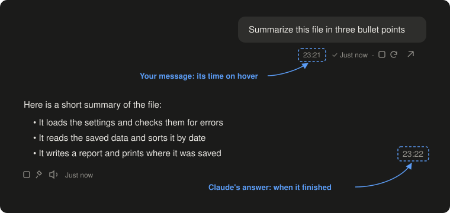

# Message timestamps for Claude Code

The Claude Code desktop app only says how long ago a message was sent ("Just now", "2 hours ago"), and you have to hover over that small label to see the real time. The terminal shows no time at all. This mod puts the time where you can see it. It also shows how long Claude took, how much context is left and when the prompt cache runs out.



It works in the desktop app and in the terminal. You can turn each part off or change it in [Settings](#settings).

## Install

In the desktop app, `/plugin` doesn't work. Install it from the message box instead:

1. Click **+** next to the message box and choose **Plugins**.
2. Click **Add marketplace** and enter `zzx-007-d/claude-message-timestamps`.
3. Click **Add plugin**.

In a terminal session of Claude Code, type:

```text
/plugin install message-timestamps --marketplace zzx-007-d/claude-message-timestamps
```

Or from a regular command line:

```shell
claude plugin install message-timestamps --marketplace zzx-007-d/claude-message-timestamps
```

New sessions pick the mod up on their own. In a session that's already open, type `/reload-plugins`.

### What you need

You need:

- Claude Code with mod support. The mod was built on version 2.1.325 and last tested on 2.1.328. Versions before 2.1.271 can't load it. Mods are an early-access feature, so a future update of Claude Code could break it.
- A Code tab session, in the desktop app or the terminal. The regular Chat tab doesn't run mods.

### Updating and turning it off

To update later, run `claude plugin update message-timestamps@zzx-007-d` and restart Claude Code.

To turn it off:

```shell
claude plugin disable message-timestamps@zzx-007-d
```

`claude plugin enable message-timestamps@zzx-007-d` turns it back on.

## What you'll see

### On Claude's answers

```text
23:21 · 2m 14s
```

Each answer shows, in grey at its bottom right, the time it finished and how long Claude took since you sent your message. It shows up together with the answer, so you don't have to hover. While Claude is still working, the length counts up.

A setting, off by default, adds how long Claude thought and how many tokens it wrote, tool calls included: `thought 40s · 12k tokens`. In the desktop app this appears to the left of the time while you point at it; in the terminal it always shows. It comes a second or two after the answer, once the answer is saved, and leaves out work done by subagents.

Slash command output, like `/reload-plugins` or `/cost`, gets a time in the same spot.

### On the newest answer: context and cache

```text
23:21 · 2m 14s · ◑ 62% · cache 42m
```

The percentage is how much context is left before Claude Code compacts the conversation on its own. The circle empties as the context fills (● ◕ ◑ ◔ ○), and the figure turns yellow under 25% and red under 10%. If you've turned auto-compaction off, it counts against the whole context instead.

The cache figure is how long until the conversation's prompt cache expires. Each message sends Claude the whole conversation, and the parts it has seen recently come from a cache, which is cheaper and faster. Every message restarts the countdown, which lasts an hour or five minutes; the mod reads which from each answer.

If you leave the chat idle past it, your next message sends everything again uncached and uses much more of your limits, more so in a long conversation. The timer turns yellow under five minutes and reads `cache expired` once it has run out.

With these two figures, the time on the newest answer goes on its own line under the answer, so the answer keeps its full width. Older answers keep the time beside their last line.

### On tool calls

Each command, edit or search Claude runs shows how long it took, in grey at the right of its row: `42s`. Calls under a second show nothing. A folded line like "Read 3 files" shows the times added up. Waiting for your permission isn't counted, except for calls made before you installed the mod, which are timed from the conversation history.

### On your messages

In the desktop app, the time appears as soon as your pointer is over the message, immediately left of the app's own label. A setting shows it all the time instead, on a small line above each message. In the terminal, it's on the line underneath.

### Day and pause lines

When a conversation runs into a new day, a line above your first message of that day names it:

```text
── Today ──        ── Yesterday ──        ── Thu 2 Oct ──
```

A conversation that has stayed within today gets none. After a pause of an hour or more, a line says how long it was, to the nearest hour: `── 3 hours later ──`.

Under these lines, times leave the date out: `08:05`, not `2 Oct, 08:05`. The only exception is an answer that finishes after midnight, which shows its date because no line comes before it.

### Messages from before you installed it

Messages sent before you installed the mod get times too. The mod reads them from the conversation history Claude Code already keeps on your computer.

## How times are written

Times follow your computer's time zone.

| Language | Today | This year | A previous year | 12-hour clock | Thinking and tokens |
| --- | --- | --- | --- | --- | --- |
| English | `23:21` | `2 Oct, 08:05` | `2 Oct 2025, 08:05` | `11:21 PM` | `thought 40s · 1.5k tokens` |
| Italiano | `23:21` | `2 ott, 08:05` | `2 ott 2025, 08:05` | `11:21 PM` | `pensato 40s · 1,5k token` |
| 中文 | `23:21` | `10月2日 08:05` | `2025年10月2日 08:05` | `下午11:21` | `思考 40s · 1.5k token` |

## Settings

Each part of the mod has a setting:

| Setting | What it does | Choices | Default |
| --- | --- | --- | --- |
| `clock` | 24- or 12-hour times | `24-hour`, `12-hour` | `24-hour` |
| `language` | How dates are written | `English`, `Italiano`, `中文` | `English` |
| `reply_time` | Where the time on Claude's answers goes | `bottom right`, `below` (its own line under the answer) | `bottom right` |
| `reply_duration` | How long Claude took | `true`, `false` | `true` |
| `reply_details` | How long Claude thought and how many tokens it wrote; puts the time on its own line | `true`, `false` | `false` |
| `context_left` | Context left before auto-compaction | `true`, `false` | `true` |
| `cache_timer` | Time until the prompt cache expires | `true`, `false` | `true` |
| `tool_time` | How long each tool call took | `true`, `false` | `true` |
| `prompt_time` | Where the time on your messages goes in the desktop app | `on hover`, `above` (always shown) | `on hover` |
| `hover_time` | The time on your messages in the desktop app | `true`, `false` | `true` |
| `day_separators` | Day and pause lines | `true`, `false` | `true` |

A change applies on its own within a few seconds. If it doesn't, type `/reload-plugins`.

### Changing a setting

The desktop app has no settings screen for mods, so it depends on what you have installed.

In a terminal session, type `/plugin configure message-timestamps@zzx-007-d` and pick the values from the menu.

If the `claude` command works on your command line, you can pipe the values to it. For example, to switch to the 12-hour clock and turn off the time on your messages:

```shell
echo '{"clock":"12-hour","hover_time":"false"}' | claude plugin configure message-timestamps@zzx-007-d --values-stdin
```

This works in PowerShell, macOS and Linux. In the Windows Command Prompt, leave out the single quotes. Settings you leave out keep their current value.

If you only have the desktop app, the `claude` command usually isn't available, so edit your settings file. Open `.claude/settings.json` in your home folder (on Windows, `C:\Users\your_user_name\.claude\settings.json`) and add this inside the outermost `{ }`, with a comma after the entry before it:

```json
"pluginConfigs": {
  "message-timestamps@zzx-007-d": {
    "options": { "clock": "12-hour", "hover_time": false }
  }
}
```

If the file already has a `pluginConfigs` section, put the `"message-timestamps@zzx-007-d"` part inside it.

## What the mod reads on your computer

To find the times of older messages, the mod reads the conversation history Claude Code saves in your `.claude` folder ([`hooks/transcript.ts`](hooks/transcript.ts)). It reads only the current session's file, and after the first read only the lines added since. It writes nothing, starts no other program, and sends nothing over the network. All of its code is in this repository.

## Known limitations

Mods can't change everything the app draws:

- The hover time on your messages sits immediately left of the app's own label, with spacing measured on one screen. With other window sizes, font settings or a later version of the app, it can overlap the label or leave a gap. Set `prompt_time` to `above` to avoid this, or see [Adjusting the position](#adjusting-the-position).
- The hover time shows up a moment before the app fades in its own label, and mods can't delay it to match.
- Claude's time can't go in the row of buttons under its answer (copy, pin, "Just now"). The app draws that row itself, and mods can't add to it.

## Adjusting the position

If the hover time overlaps the app's label or leaves a gap, change the matching number in `HOVER_TOOLBAR` at the bottom of [`hooks/register.tsx`](hooks/register.tsx). There's one for each kind of label the app shows ("Just now", "5 minutes ago", "3 hours ago", "2 days ago", a date). A bigger number moves the time further left.

A copy installed from GitHub doesn't pick up your edits. First clone this repository, add your clone with `claude plugin marketplace add path_to_your_clone`, and install from it. Then edit the file in your clone and type `/reload-plugins`.

## Running the tests

In this folder, `claude plugin test .` runs the tests and `claude plugin validate .` checks the mod for errors.

## License

MIT. See [LICENSE](LICENSE).
